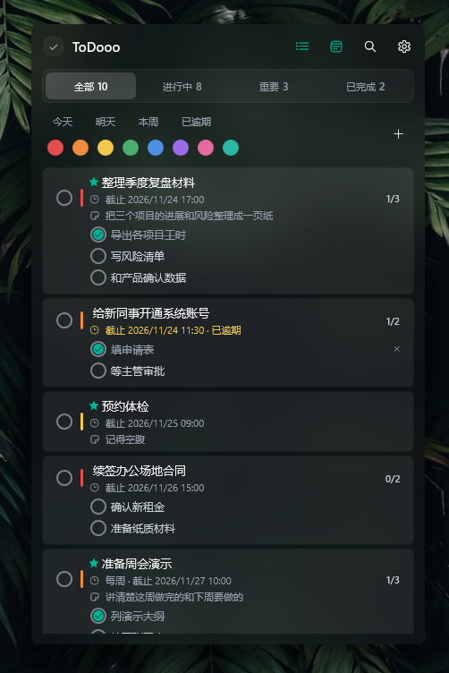
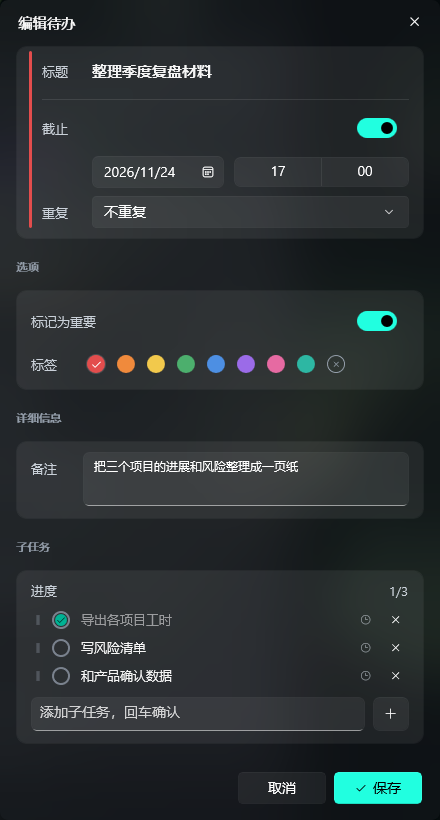
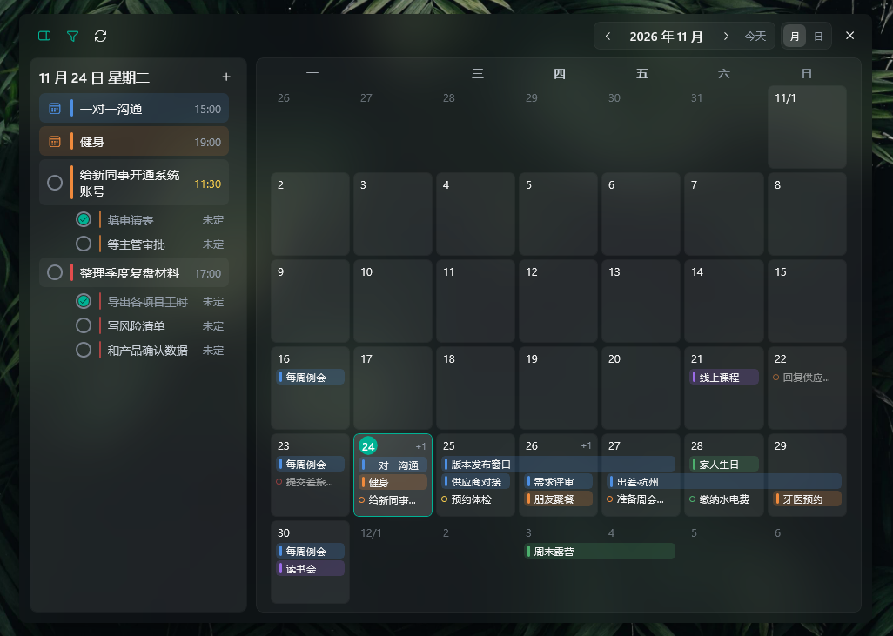

# ToDooo

[English](README.md) · [简体中文](README.zh-CN.md)

A lightweight Windows 11 desktop todo and calendar companion built with **WinUI 3**, **.NET 11**, and **SQLite**. Todos stay on your machine; calendar events sync with iCloud.

<p align="center">
  
</p>

## Features

### Todos

- **Quick capture with natural language** — Type inline, or open the full editor. Dates and times are parsed automatically (`tomorrow 3pm`, `friday 10:30`), as are recurrence (`daily` / `weekly` / `monthly`) and importance (`!important` / `!!`).
- **Subtasks & notes** — Each task can carry subtasks, each with its own note, due time, and drag-reorder. When every subtask is checked you're asked whether to complete the parent too.
- **Views, tags & batch actions** — Filter tabs (All / Active / Important / Done) with a configurable default, reorderable smart views (Today / Tomorrow / This Week / Overdue), 8 color tags, live search, and one-click postpone of everything overdue to today.
- **Reminders & hotkeys** — Windows toast notifications with **Mark Done** and **Snooze 10 min** buttons on the notification itself, plus global hotkeys for showing the window and quick capture, tray menu, launch at startup, and JSON import/export.
- **Acrylic appearance** — Follows the system theme live, with a transparency slider and optional fade-on-mouse-leave.

<p align="center">
  
</p>

### Calendar

- **Two-way iCloud sync** — Connect with an Apple ID and an app-specific password. Events live in iCloud; todos stay local. Writes apply locally first and are pushed in the background, with a persistent retry queue for offline use.
- **Month and day views** — Multi-day events render as continuous bars laid out by week; single-day events and todos are mixed into the cells by time.
- **Per-calendar colors and filters** — Colors come from iCloud, and each calendar can be toggled on or off.
- **Drag to reschedule** — Drag a single-day event onto another date and the change syncs right away.
- **Recurring events** — Daily / weekly / biweekly / monthly / yearly, with EXDATE and per-occurrence overrides handled correctly. Editing or deleting offers "this event only" or "the whole series".
- **Move between calendars** — Reassign an event to a different calendar.
- **Free window** — The calendar is an independent window that remembers its position and size, and resizes from all four edges and corners.

<p align="center">
  
</p>

### Settings

- Categorized into General / Reminders / Calendar, with a sidebar that collapses to icons on narrow windows.
- The calendar page walks through generating an app-specific password, with a direct link to `account.apple.com` — including the note that changing your Apple ID password invalidates every app-specific password.

## Install

- **Installer (recommended)** — Download `ToDooo-<version>-setup.exe` from [Releases](https://github.com/yeyt97/ToDooo/releases). It installs per-user (no admin prompt) and adds a Start Menu shortcut and an uninstaller.
- **Portable** — Download `ToDooo-<version>-win-x64.zip`, extract anywhere, and run `ToDooo.exe`.

Both forms share `%LocalAppData%\ToDooo`, so reinstalling or replacing files keeps your tasks, settings, and calendar cache. Builds are not code-signed yet, so SmartScreen may ask you to confirm on first run.

## Requirements

- **Runtime**: Windows 11 22H2 (Build 22621) or later, `x64`
- **Build from source**: [.NET 11 SDK](https://dotnet.microsoft.com/) with the Windows App SDK workload

The calendar connection needs an Apple ID with two-factor authentication enabled, so that an app-specific password can be generated.

## Build, Test & Publish

```powershell
# Build (Debug)
dotnet build src/ToDooo.App/ToDooo.csproj -p:Platform=x64

# Run unit tests
dotnet test tests/ToDooo.Tests/ToDooo.Tests.csproj

# Publish a self-contained Release build (end users need no .NET runtime)
dotnet publish src/ToDooo.App/ToDooo.csproj -c Release -p:Platform=x64 -p:PublishProfile=win-x64

# One-step release: bump version (csproj + manifest), test, publish, pack ZIP and installer
pwsh scripts/release.ps1 -Version 1.6.0
```

The live iCloud tests are skipped unless both `CALDAV_APPLE_ID` and `CALDAV_APP_PASSWORD` are set:

```powershell
$env:CALDAV_APPLE_ID = 'you@example.com'
$env:CALDAV_APP_PASSWORD = 'xxxx-xxxx-xxxx-xxxx'
dotnet test --filter LiveICloud
```

Version numbers live in `ToDooo.csproj` and `app.manifest`; the settings page reads the assembly version at runtime. Pushing a `v*` tag triggers `.github/workflows/release.yml`, which re-runs tests, packs the ZIP and installer, and publishes a GitHub Release.

## Screenshots with demo data

The images above are rendered from a throwaway dataset, not from real user data. To regenerate them:

```powershell
$env:TODOOO_DATA_DIR = 'C:\temp\todooo-demo'
python scripts/make-demo-data.py
# launch the app with the same variable set, then:
pwsh scripts/capture-readme-shots.ps1
```

`TODOOO_DATA_DIR` moves the whole data directory and the single-instance key, so a demo instance can run alongside your normal one without touching real data.

## Project Structure

```text
src/ToDooo.App/
├── MainWindow.xaml(.cs)         # Window lifecycle, hotkeys, WndProc, calendar/settings host
├── MainWindow.Tray.cs           # Tray icon and menus, undo bar, JSON import/export, toast callbacks
├── MainWindow.Dock.cs           # Edge resizing and synchronized top-edge retract
├── MainWindow.Filters.cs        # Search bar, filter tabs, tag dots, smart views, accelerators
├── MainWindow.Todos.cs          # Quick add, task cards, context menus, subtask interactions
├── Models/                      # TodoItem, SubtaskItem, SmartView, CalendarEvent
├── Services/                    # SQLite repositories, settings, reminders, CalDAV sync, iCalendar
├── ViewModels/                  # MainViewModel filtering, sorting, persistence orchestration
├── Views/                       # Calendar host and pane, settings, editors, month layout
├── Helpers/                     # NaturalDateParser, Bind, DpiScale, TimePickerSizing, WindowEdgeResize
├── Interop/                     # NativeMethods, WindowAcrylic, WindowCloak, WindowSnap, TrayIcon
└── Themes/                      # Shared brushes and control styles
tests/ToDooo.Tests/              # xUnit tests (models, ViewModel, repositories, parser, iCalendar)
scripts/                         # release.ps1, demo data and README screenshot helpers
```

## How the calendar sync works

- **Masters, not flattened copies** — Synced resources are stored as the original `.ics` text, and occurrences are expanded when read. This keeps `RRULE`, `EXDATE`, and `RECURRENCE-ID` overrides authoritative instead of drifting from a second copy.
- **Local-first writes** — Every create, edit, and delete applies locally first, then pushes. Failures go into a persistent queue that is replayed on reconnect; the sync icon shows a small amber dot while anything is pending.
- **Coalesced drags** — Dragging several events in a row batches into a single push after a short quiet period, instead of one connection per event.
- **Moving between calendars** — CalDAV has no move operation, so an event is re-created in the target collection and the old resource is deleted, with the deletion queued if it fails.

## Local Data

Stored under `%LocalAppData%\ToDooo\`:

- `todo.db` — SQLite database for tasks, subtasks, calendar cache, and the pending-sync queue
- `settings.json` — Theme, transparency, default tab, hotkeys, tag names, smart views, window bounds, and the encrypted calendar password

The calendar password is encrypted with Windows DPAPI (current user scope), so copying `settings.json` to another machine or account does not expose it.

Replacing the executable directory preserves all local data.

## License

[MIT](LICENSE) © 2026 yyt
