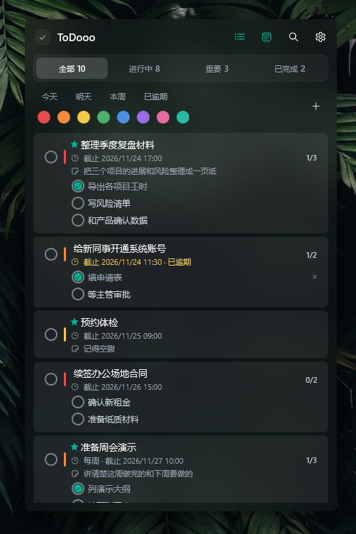
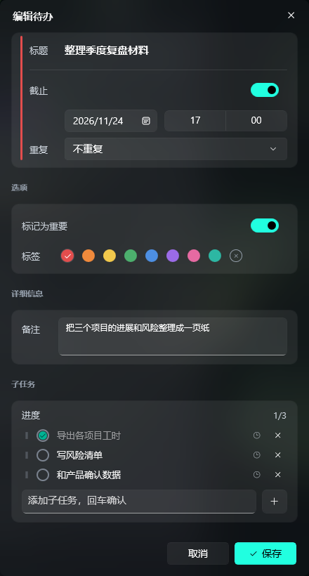
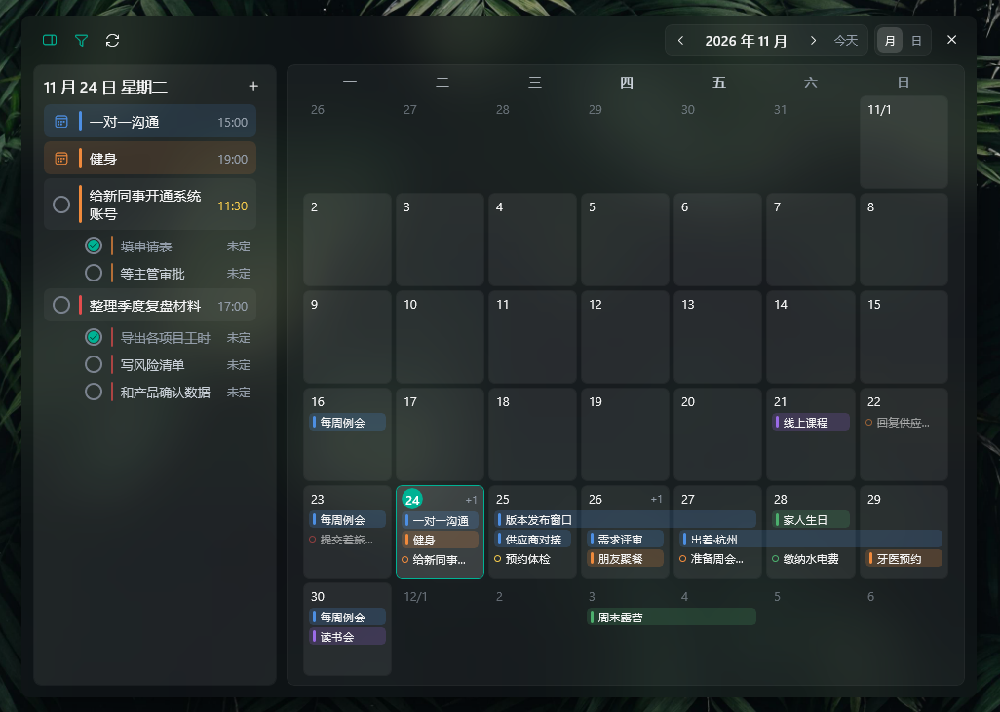

# ToDooo

[English](README.md) · [简体中文](README.zh-CN.md)

轻量级 Windows 11 桌面待办与日历工具（WinUI 3 / .NET 11 / SQLite）。待办只保存在本机，日历日程与 iCloud 双向同步。

<p align="center">
  
</p>

## 功能特性

### 待办

- **快速输入与自然语言解析** — 主添加栏直接敲，或打开完整编辑窗。日期时间自动识别（`明天下午3点`、`周五 10:30`），重复周期（`每天` / `每周` / `每月`）和重要标记（`!重要` / `!!`）同样识别。
- **子任务与备注** — 每条待办可带子任务，各自有备注、截止时间和拖动排序。子任务全部勾完时会询问是否一并完成主任务。
- **筛选、标签与批量操作** — 「全部 / 进行中 / 重要 / 已完成」筛选标签（可设默认），可排序的智能视图（今天 / 明天 / 本周 / 已逾期），8 色标签，实时搜索，以及一键把所有逾期项顺延到今天。
- **提醒与热键** — Windows 系统通知上直接带「标记完成」和「推迟 10 分钟」按钮；支持全局呼出与快速记一条热键、托盘菜单、开机自启、JSON 导入导出。
- **亚克力外观** — 跟随系统深浅色，`0%–90%` 透明度调节，可选鼠标离开时自动变淡。

<p align="center">
  
</p>

### 日历

- **iCloud 双向同步** — 用 Apple ID 和应用专用密码连接。日程存在 iCloud，待办仍然只在本机。所有写入先落本地再后台推送，断网时进入持久队列等待补传。
- **月视图与日视图** — 跨日日程按周排成连续色条；单日日程和待办按时间混排进格子里。
- **按日历配色与筛选** — 颜色取自 iCloud，每个日历可以单独开关是否显示。
- **拖拽改期** — 把单日日程拖到另一天，改动立即同步。
- **循环日程** — 每天 / 每周 / 每两周 / 每月 / 每年，正确处理 EXDATE 和单次覆盖。编辑或删除时可选「仅这一次」或「整个系列」。
- **改所属日历** — 日程可以在不同日历之间移动。
- **独立窗口** — 日历是独立窗口，记住位置和尺寸，四边四角都能拖拽缩放。

<p align="center">
  
</p>

### 设置

- 分为通用 / 提醒事项 / 日历三类，窗口变窄时侧栏收缩成图标。
- 日历页带一份应用专用密码的获取教程，一键直达 `account.apple.com`，并说明「改过 Apple 账户主密码后专用密码会全部失效」这个常见坑。

## 安装

- **安装版（推荐）** — 从 [Releases](https://github.com/yeyt97/ToDooo/releases) 下载 `ToDooo-<版本>-setup.exe`。按用户安装，不需要管理员权限，自动创建开始菜单快捷方式和卸载项。
- **便携版** — 下载 `ToDooo-<版本>-win-x64.zip`，解压到任意目录运行 `ToDooo.exe`。

两种形式共用 `%LocalAppData%\ToDooo`，重装或覆盖文件都不会丢失待办、设置和日历缓存。目前安装包未做代码签名，首次运行可能被 SmartScreen 拦一次，点「更多信息 → 仍要运行」即可。

## 运行与构建环境

- **运行环境**：Windows 11 22H2（22621）及以上，`x64`
- **从源码构建**：[.NET 11 SDK](https://dotnet.microsoft.com/) 及 Windows App SDK 工作负载

日历功能需要账户开启双重认证，才能生成应用专用密码。

## 构建、测试与发布

```powershell
# 构建（Debug）
dotnet build src/ToDooo.App/ToDooo.csproj -p:Platform=x64

# 运行单元测试
dotnet test tests/ToDooo.Tests/ToDooo.Tests.csproj

# 发布自包含 Release 版（终端用户无需安装 .NET 运行时）
dotnet publish src/ToDooo.App/ToDooo.csproj -c Release -p:Platform=x64 -p:PublishProfile=win-x64

# 一步发版：改版本号（csproj + manifest）、跑测试、发布、打 ZIP 和安装包
pwsh scripts/release.ps1 -Version 1.6.0
```

真实 iCloud 测试默认跳过，只有同时设置两个环境变量才会运行：

```powershell
$env:CALDAV_APPLE_ID = 'you@example.com'
$env:CALDAV_APP_PASSWORD = 'xxxx-xxxx-xxxx-xxxx'
dotnet test --filter LiveICloud
```

版本号写在 `ToDooo.csproj` 和 `app.manifest` 里，设置页运行时读取程序集版本。推送 `v*` 标签会触发 `.github/workflows/release.yml`，重新跑测试、打包 ZIP 与安装包并发布 GitHub Release。

## 截图与演示数据

上面的截图用的是完全虚构的数据，不是真实用户数据。重新生成：

```powershell
$env:TODOOO_DATA_DIR = 'C:\temp\todooo-demo'
python scripts/make-demo-data.py
# 用同样的环境变量启动应用，然后执行：
pwsh scripts/capture-readme-shots.ps1
```

`TODOOO_DATA_DIR` 会一并切换数据目录和单实例名，所以演示实例可以和正常实例同时运行，互不影响。

## 项目结构

```text
src/ToDooo.App/
├── MainWindow.xaml(.cs)         # 窗口生命周期、热键、WndProc、日历与设置宿主
├── MainWindow.Tray.cs           # 托盘图标与菜单、撤销条、JSON 导入导出、通知回调
├── MainWindow.Dock.cs           # 边缘缩放与顶部收边
├── MainWindow.Filters.cs        # 搜索栏、筛选标签、标签色点、智能视图
├── MainWindow.Todos.cs          # 快速添加、任务卡片、右键菜单、子任务交互
├── Models/                      # TodoItem、SubtaskItem、SmartView、CalendarEvent
├── Services/                    # SQLite 仓储、设置、提醒、CalDAV 同步、iCalendar 读写
├── ViewModels/                  # MainViewModel 筛选、排序与持久化编排
├── Views/                       # 日历宿主与面板、设置、各编辑窗、月视图排布
├── Helpers/                     # NaturalDateParser、Bind、DpiScale、TimePickerSizing、WindowEdgeResize
├── Interop/                     # NativeMethods、WindowAcrylic、WindowCloak、WindowSnap、TrayIcon
└── Themes/                      # 共享画刷与控件样式
tests/ToDooo.Tests/              # xUnit 测试（模型、ViewModel、仓储、解析器、iCalendar）
scripts/                         # release.ps1、演示数据与 README 截图脚本
```

## 日历同步是怎么做的

- **存母事件，不存展开副本** — 同步下来的资源保存为原始 `.ics` 文本，读取时再展开。这样 `RRULE`、`EXDATE` 和 `RECURRENCE-ID` 覆盖始终以原始文件为准，不会因为维护第二份副本而逐渐走偏。
- **本地优先** — 新建、编辑、删除都先落本地再推送。失败进入持久队列，恢复后补传；有积压时同步图标上会出现一个橙色小点。
- **拖拽合并推送** — 连续拖动多条日程时，会在短暂静默期后合并成一次推送，而不是每条都新建一次连接。
- **跨日历移动** — CalDAV 没有移动操作，因此会在目标集合重新创建再从旧集合删除；删除失败就排队补删。

## 本地数据

保存在 `%LocalAppData%\ToDooo\`：

- `todo.db` — SQLite 数据库，含待办、子任务、日历缓存和待同步队列
- `settings.json` — 主题、透明度、默认标签、热键、标签名、智能视图、窗口位置，以及加密后的日历密码

日历密码用 Windows DPAPI（当前用户范围）加密，把 `settings.json` 拷到别的机器或账户下也解不开。

替换程序目录不会影响任何本地数据。

## 许可证

[MIT](LICENSE) © 2026 yyt
